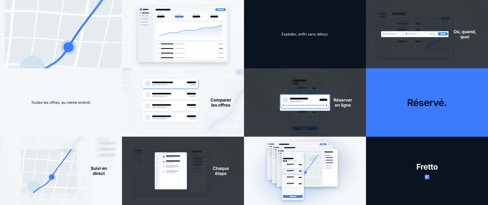

# sebmake-videopresentation-likeapplepls

Une skill Claude Code qui fabrique un film produit muet d'une à deux minutes, monté comme les films de révélation qu'Apple glisse dans ses keynotes, puis le recoupe en versions de 15 à 60 secondes pour les réseaux. Personne ne parle : le texte à l'écran porte le message, avec votre musique si vous en avez une.

*English below.*

## D'où viennent les règles

Avant d'écrire une ligne de code, on a mesuré 51 films tirés de huit keynotes Apple, de mars 2019 à septembre 2026 : la durée de chaque plan, le nombre de cartons, le temps pendant lequel un texte reste à l'écran, le moment où le produit se montre enfin. Plusieurs constats sont passés tels quels dans le moteur. Le nom du produit tombe dans le dernier quart du film, à peu près quatre secondes avant la fin, et l'objet entier n'apparaît qu'après 60 % de la durée. Le rythme dessine un U, avec des plans d'environ trois secondes au début, à peine plus d'une seconde au milieu, puis une révélation qu'on laisse tenir cinq secondes. Un carton reste affiché 1,2 s, plus 0,3 s par mot.

Pour d'autres règles, le corpus ne permettait aucune mesure, et la skill le dit noir sur blanc. Aucun film du corpus n'est vertical, donc tout ce qui touche au 9:16 relève de la convention ; quant aux coupes, elles ne tombent pas plus souvent sur les temps de la musique que le hasard ne le prévoit (16 coïncidences contre 16,4 attendues, sur les six films dont on a pu récupérer le son), si bien que le calage au tempo reste une option qu'on vous propose.

## Comment elle travaille

Elle commence par vous interroger : le produit, la phrase que le public doit retenir, les visuels dont vous disposez (photos détourées, captures, enregistrements d'écran, logo), un lien vers votre design system ou vos couleurs en HEX, les formats voulus, la musique. Elle vous montre ensuite la structure du film puis une planche de storyboard, et rien ne part au rendu tant que vous n'avez pas validé.

Le rendu passe par [HyperFrames](https://www.npmjs.com/package/hyperframes). Vous obtenez un MP4 en 16:9, puis des déclinaisons en 9:16 et en 1:1 recomposées plan par plan : le texte et l'objet changent de place pour tenir dans le cadre, on ne se contente pas de rogner les bords.

Douze recettes de plans servent de briques, dont une lumière qui balaie l'objet, une fausse orbite en 3D, un gros plan avec mise au point, une vue éclatée en couches, un panneau d'interface flottant qui zoome sur un détail et un empilement de fenêtres.

Deux interdits tiennent quoi qu'il arrive. Elle n'invente aucun chiffre : un carton qui attend un chiffre absent du brief affiche `[À FOURNIR]`, estompé, jusqu'à ce que vous le remplaciez. Et elle ne va chercher aucune musique ailleurs ; sans fichier fourni, le film reste muet.



## Installation

En plugin Claude Code :

```bash
claude plugin marketplace add sebmake/sebmake-videopresentation-likeapplepls
claude plugin install sebmake-videopresentation-likeapplepls@sebmake-video
```

À la main, copiez `skills/sebmake-videopresentation-likeapplepls` dans `~/.claude/skills/`.

Il vous faut Node 18 ou plus, ffmpeg et Python 3.9 ou plus. HyperFrames se télécharge tout seul par `npx` au premier rendu, et les polices Google demandent une connexion la première fois. Le fichier `.skill` de la release s'importe dans Claude.ai, mais le rendu vidéo a besoin d'une machine où tournent Node et un navigateur, donc Claude Code reste le bon endroit.

## Ce qui reste à éprouver

Sur l'exemple livré avec la skill, planche et rendus prennent un peu plus d'une minute. Le film de test, lui (une application de réservation de transport inventée, quatre captures schématiques, pas de musique), traîne un peu : avec si peu de visuels, le texte occupe l'écran 60 % du temps, et le contrôle vous prévient maintenant quand les visuels manquent. Personne n'a encore essayé la skill sur une vraie musique, ni avec les recettes pensées pour un objet physique.

Les trois vidéos de ce test (88 s en 16:9, 30 s en vertical, 15 s en carré) sont jointes à la release v1.0.0.

---

## English

A Claude Code skill that makes a silent product film, one to two minutes long, cut like the reveal films Apple runs during its keynotes, then trims it into 15 to 60 second versions for social media. Nobody speaks; on-screen text carries the message, over your own music if you have some.

The rules come from 51 films measured across eight Apple keynotes (2019 to 2026). The product name lands in the last quarter, about four seconds before the end, and a text card stays up 1.2 s plus 0.3 s per word. Vertical rules and beat-synced cuts aren't backed by the corpus, and the skill labels them as conventions.

It asks about your product, your visuals and your brand colours (or a design-system link), shows you the structure and a storyboard, and only renders once you've approved them. Output is a 16:9 MP4 plus 9:16 and 1:1 versions that get recomposed rather than cropped. It won't invent a figure (missing ones show as `[TO PROVIDE]`) and it won't fetch music you didn't supply.

Install with `claude plugin marketplace add sebmake/sebmake-videopresentation-likeapplepls`, then `claude plugin install sebmake-videopresentation-likeapplepls@sebmake-video`, or copy the skill folder into `~/.claude/skills/`. You'll need Node 18+, ffmpeg and Python 3.9+.

---

Not affiliated with, endorsed or sponsored by Apple Inc. Apple and Keynote are trademarks of Apple Inc., registered in the U.S. and other countries. Licence MIT.
